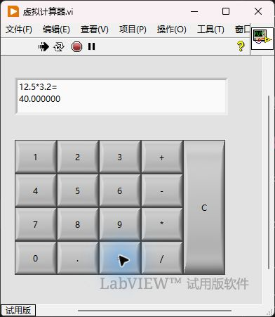

# LabVIEW 简易计算器

《虚拟仪器与检测技术》实验1工程。采用 LabVIEW 2023 32位实现事件驱动的二元四则运算，包含原生 VI、项目、独立 EXE、实验报告和实际测试证据。

## 打开和运行

1. 使用 LabVIEW 2023 32位打开 `虚拟计算器.lvproj`，再打开 `虚拟计算器.vi`。
2. 点击运行箭头，按“第一个数 → 运算符 → 第二个数 → =”输入。每次新计算前按 C。
3. 需要观察内部状态时，打开 `虚拟计算器_六控件查看.vi`。该副本仅将五个辅助字符串控件取消隐藏，算法相同；不要同时运行两个副本混合观察。
4. 在开发环境中使用中止按钮停止程序；独立应用可关闭窗口退出。

独立程序位于 `builds/虚拟计算器/虚拟计算器.exe`。复制到其他电脑时保留同目录的 INI、aliases 文件，并安装兼容的 LabVIEW 2023 32位运行引擎。本仓库不包含 NI 软件安装包或离线运行引擎。

## 程序设计

前面板包含数字0至9、小数点、四则运算、等号和 C 共17个布尔按键。

| 字符串控件 | 功能 |
| --- | --- |
| 输入临时值 | 逐位追加当前操作数 |
| 输入1 | 按运算符时保存第一个操作数 |
| 输入2 | 按等号时保存第二个操作数 |
| 运算符临时值 | 保存当前四则运算符 |
| 运算结果 | 保存六位小数格式的结果字符串 |
| 过程显示 | 充当计算器显示器，显示算式及换行后的结果 |

六个空字符串常量在 While 循环外初始化。循环内的事件结构处理数字与小数点、运算符、等号、清除事件。等号事件中的条件结构执行四则运算，在结构外统一转换并显示结果。C 清除六项状态，不结束程序。

本实验实现一次二元运算，不增加连算优先级、非法输入纠错或除零提示；应使用有效操作数且除数不为零。

## 自选数据实测

2026年10月24日通过真实前面板按键输入，并读取六个控件的值逐项断言。以下数据与指导书示例不同，每组运算前先按 C。

| 测试 | 实际结果 | 判定 |
| --- | --- | --- |
| 初始化 | 六项均为空字符串 | 通过 |
| 18+7 | 25.000000 | 通过 |
| 6-14 | -8.000000 | 通过 |
| 12.5*3.2 | 40.000000 | 通过 |
| 22/8 | 2.750000 | 通过 |
| 非空状态按 C | 六项全部清空 | 通过 |

逐项记录见 [new_data_tests.json](evidence/new_data_tests.json)。独立 EXE 通过按键输入验证 `22/8=2.750000`、C 清空和关闭窗口退出；运行截图及观察记录见 `evidence/exe_new_sample_division.png`、`evidence/exe_new_data_test.json`。

## 文件说明

- `虚拟计算器.vi`、`虚拟计算器_六控件查看.vi`：主程序与辅助观察副本。
- `虚拟计算器.lvproj`：包含应用程序生成规范的项目。
- `source/虚拟计算器.aixml`：图形程序的文本源表示。
- `算法流程图.svg`：初始化、判断、存储、运算和显示流程。
- `实验1简易计算器设计实验报告_优化版.docx`、同名 PDF：6页优化报告，测试表及截图使用上述自选数据。姓名、学号、班级和实验日期留待本人填写。
- `evidence/main.html`、`evidence/six_controls.html`：原生 LabVIEW 导出的程序框图及控件视图，配套 PNG 保存在同目录。
- `build-result.json`：实际构建结果的公开副本，仅将本机绝对路径改为仓库相对路径。
- `tools/build_exe.py`：通过本机已安装的 NI Application Builder 重新生成 EXE；需要 Windows、LabVIEW 2023 32位、Application Builder 和安装了 pywin32 的 Python。

上传副本不包含旧版报告、旧测试示例、开发环境临时状态、课程指导书 PDF、安装包或许可激活工具。原生 VI 和 EXE 保持已验证版本，未因发布而修改；EXE 的 aliases 仅保留 localhost 映射。

## 来源与第三方许可

实验算法、控件名称和按键布局依据课程实验指导书。

生成原生 VI 时使用了 [Zuehlke/labview-mcp](https://github.com/Zuehlke/labview-mcp) 的源代码转换工具、pylabview 读写器及原生控件片段，未安装或启用其远程服务。许可见 `LICENSE_NATIVE_TOOLS`、`LICENSE_PYLABVIEW`。

标准3D控件样式参考 [RuyerZ/NaiveLabviewCalculator](https://github.com/RuyerZ/NaiveLabviewCalculator)，许可见 `LICENSE_UI_STYLE`；没有沿用其三状态与运算子 VI 算法。第三方许可全文随工程保留。
